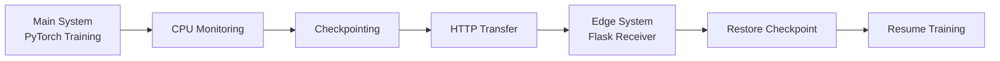

# Checkpoint-Based Migration of ML Training Tasks Across Local and Edge Systems

<p align="center">
  
  
  
  
</p>

## Overview

A checkpoint-based migration system that transfers machine learning training workloads from a main system to an edge system when CPU utilization exceeds a predefined threshold.

The system periodically saves model and optimizer states, transfers the latest checkpoint over HTTP, and resumes training on the destination system without restarting from scratch.

## Architecture



## Tech Stack

- **Language:** Python
- **ML Framework:** PyTorch
- **Dataset:** MNIST
- **Communication:** HTTP, Flask
- **Resource Monitoring:** psutil
- **Containerization:** Docker

## Project Structure

```text
├── laptop1/
│   ├── train.py
│   ├── model.py
│   ├── requirements.txt
│   └── Dockerfile
│
├── laptop2/
│   ├── receiver.py
│   ├── resume.py
│   ├── model.py
│   ├── requirements.txt
│   └── Dockerfile
│
└── README.md
```

## Workflow

1. Train a CNN model on the main system.
2. Monitor CPU utilization continuously.
3. Save checkpoints at regular intervals.
4. Trigger migration when CPU usage exceeds the configured threshold.
5. Transfer the latest checkpoint to the edge system.
6. Restore the model and optimizer states.
7. Resume training from the saved epoch.

## Configuration

| Parameter | Value |
|---|---:|
| Training epochs | 30 |
| Batch size | 64 |
| Learning rate | 0.001 |
| Checkpoint interval | 5 epochs |
| CPU threshold | 72% |

## Running the Project

**Edge System:**

```bash
cd laptop2
docker build -t edge-system .
docker run -d --name edge-system -p 5000:5000 edge-system
```

**Main System:**

Update the edge system IP address in `laptop1/train.py`, then run:

```bash
cd laptop1
docker build -t main-system .
docker run --name main-system main-system
```

Both systems must be reachable over the network. Configure persistent Docker volumes as shown in the project setup when running experiments.

## Evaluation Metrics

- Checkpoint creation time and size
- Checkpoint transfer time
- Checkpoint restoration time
- CPU and memory utilization
- Training progress preserved during migration

## Future Scope

- Adaptive checkpoint scheduling
- Network-aware migration
- Secure checkpoint transfer
- Multi-node edge migration


